  

  
  
  

<a href="#a-little-about-me">About</a> · <a href="#experience">Experience</a> · <a href="#tools-i-build-with">Tech stack</a> · <a href="#projects">Projects</a> · <a href="#education--learning">Education</a>

## A little about me

I'm **Thulasi Vasan S**, a Machine Learning Engineer based in **India**. I build AI-powered applications, backend systems, and workflow automation — from RAG assistants and agentic systems to APIs and engineering-data tools.

At **Invisibl Cloud**, my work connects models with retrieval, tools, persistent state, and cloud services. I've contributed to product-support assistants, reusable multi-agent orchestration, engineering-document extraction, automotive simulation analytics, and Go-based business platforms.

My background spans **applied AI, backend engineering, and full-stack development**. I enjoy working across those boundaries: shaping the API, connecting the data, orchestrating the workflow, and making the system dependable for the people using it.

## Experience

### Invisibl Cloud

**Machine Learning Engineer** · Jul 2025 – Present  
**Machine Learning Engineer Intern** · Jan 2025 – Jun 2025

Across my internship and full-time roles:

- **RAG & agentic AI:** Built backend and agentic-AI components for a product-support assistant that reached UAT, using AWS Bedrock, AgentCore, and Strands Agents. Implemented product-aware query routing, retrieval fallbacks, and grounded response generation.
- **Workflow orchestration:** Engineered reusable capabilities for long-running, multi-agent workflows with FastAPI, Burr state machines, dynamic DAGs, persistent state, and MCP-based service and tool selection.
- **Engineering-data APIs:** Developed PDF and STEP extraction APIs for structured tables and engineering attributes used in RFQ and cost-estimation workflows.
- **CAE automation:** Automated force and stroke analysis across five simulation models, producing plots, CSVs, images, and visualization outputs. Analyzed 16 overlap-crash models for response classification.
- **Go backend development:** Contributed REST APIs to a loaner-device and repair-case platform, supporting MongoDB-backed workflows, JWT authorization, QR-code functions, and cloud integrations.

### God Particles

**Web Developer Intern** · Jul 2023 – Dec 2023

- Developed web applications with **React and Angular**, improving performance and user experience.
- Built an **Angular HRMS** and contributed to e-commerce sites using **WordPress and Shopify**.

## Tools I build with

### Languages

**Python · Go · JavaScript · TypeScript · SQL**

### AI, retrieval & orchestration

**AWS Bedrock · Bedrock AgentCore · Strands Agents · RAG · MCP · Burr**  
Hugging Face Transformers & Datasets · PyTorch · scikit-learn · FAISS · Azure OpenAI · Dynamic DAGs

### Backend & databases

FastAPI · REST APIs · Flask · Gorilla Mux · Node.js · Express · MongoDB · Aurora PostgreSQL · Elasticsearch · JWT

### Frontend

React · Angular · TypeScript · Vite · Tailwind CSS · Sass

### Cloud & development

AWS Lambda · API Gateway · S3 · GCP · Docker · Git · GitHub Pages

### Engineering automation

PDF & STEP processing · Altair HyperWorks · HyperGraph · HyperView · LS-DYNA data processing

## Projects

### Professional work

| Project | What I contributed |
| --- | --- |
| **Product-Support RAG Assistant** | Product-aware routing, retrieval, fallbacks, and grounded answers for a UAT-deployed financial-services assistant. |
| **Configurable AI Workflow Supervisor** | Stateful orchestration, configuration-driven workflows, dynamic DAGs, and MCP-based tool selection. |
| **Engineering Document Extraction** | APIs for PDF tables and STEP attributes supporting RFQ and cost estimation. |
| **Automotive CAE Analytics** | Automated force/stroke comparisons, visualization outputs, and simulation-response classification. |
| **Loaner Device Lifecycle Platform** | Go APIs and authorization for inventory, repair cases, assignments, returns, and related workflows. |

These are anonymized professional case studies. Client source code is not available in my public repositories. [Read more in my portfolio →](https://sasuke-uchiha.vercel.app/)

### Personal projects

#### [Spoken Language Identification](https://github.com/sasuke-uchiha12/spoken-language-identification)

A fine-tuning pipeline for **22 Indian languages**, using `facebook/mms-300m` and an open speech dataset. Includes per-language accuracy, confusion matrices, and speaker-level validation diagnostics.

Python · PyTorch · Hugging Face Transformers · Datasets · scikit-learn

#### [Movie Review 2.0](https://github.com/sasuke-uchiha12/Movie-Review-2.o)

A movie-review application with a React frontend and Flask/MongoDB backend code. Uses **TextBlob sentiment scoring** to sort reviews. The published [GitHub Pages demo](https://sasuke-uchiha12.github.io/Movie-Review-2.o/) is a static frontend.

React · Python · Flask · MongoDB · TextBlob

#### [MCS Website](https://github.com/sasuke-uchiha12/MCS-Website)

A responsive website for the **Math Computing Society**, presenting its activities, events, and learning resources. [View the static demo →](https://sasuke-uchiha12.github.io/MCS-Website/)

React · React Router · Sass · GitHub Pages

## Education & learning

**Integrated M.Sc. in Information Technology** · 2020–2025  
College of Engineering, Guindy, Anna University · **CGPA: 8.23**

Coursework includes **Model Context Protocol (Introduction & Advanced)**, **Hugging Face Agents (Unit 1)**, and **OpenAI Agents & Workflows**.

  

Glass artwork adapted from <a href="https://github.com/ryanpolasky/ryme.md">RyMe.md</a> · <a href="assets/RYME-LICENSE.txt">MIT license</a>
