  

  
  
  

### A little about me

I'm a **Machine Learning Engineer at Invisibl Cloud**, building RAG assistants, agentic workflows, and backend APIs. I enjoy connecting AI models with the tools, data, and orchestration they need to solve practical problems.

🎓 Integrated M.Sc. IT · College of Engineering, Guindy, Anna University (2020–2025)

### Tools I build with

  

**AI & orchestration:** AWS Bedrock · AgentCore · Strands Agents · RAG · MCP · Burr  
**Data:** MongoDB · Aurora PostgreSQL · Elasticsearch

### Selected work

**01 / Product-Support RAG Assistant**  
Built backend and agentic-AI components for a UAT-deployed assistant, with product-aware routing, retrieval, and grounded responses.  
Python · AWS Bedrock · AgentCore · Strands Agents

**02 / Configurable AI Workflow Supervisor**  
Engineered reusable capabilities for long-running, multi-agent workflows: dynamic DAGs, persistent state, and MCP-based tool selection.  
Python · FastAPI · Burr · MCP · Elasticsearch

**03 / Engineering Data & CAE Automation**  
Developed PDF and STEP extraction APIs and automated crash-simulation analysis, turning engineering data into comparisons, plots, and reports.  
Python · Altair HyperWorks · LS-DYNA data processing

Professional project summaries. Client source code is not available in my public repositories.

---

<a href="https://sasuke-uchiha.vercel.app/">Explore my portfolio ↗</a>

